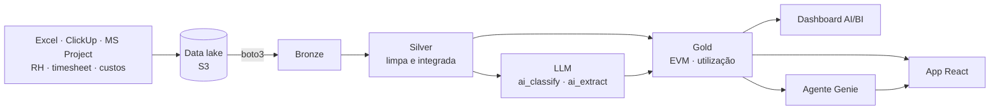

<h1 align="center">Jéssica Fuentes</h1>

  <b>Analista de Dados · BI · Engenharia de Dados</b> 
  SQL · Power BI · Python · Databricks · IA aplicada a dados

  📍 São Paulo (híbrido ou remoto) &nbsp;|&nbsp; Aberta a vagas de Analista de Dados, Analista de BI e Engenheira de Dados

  
  

---

## Sobre mim

Passei 18 anos em Comércio Exterior, Logística e Operações em multinacionais, os últimos como Analista de Comex Sênior. Foi lá que comecei a resolver problema com dado: dashboard de free time de contêiner, controle de vencimentos, custo de frete por rota e transportadora. Agora estou migrando de vez para a área de dados.

Sou formada em **Análise e Desenvolvimento de Sistemas**. Uso **SQL, Power BI (DAX e Power Query), Excel e Python** e construo pipelines no **Databricks**, da ingestão ao produto final. Uso IA em duas frentes: **dentro do pipeline** (LLM lendo texto livre, agente respondendo perguntas sobre os dados) e **no desenvolvimento**, com Claude Code.

---

## Resultados na experiência profissional

| Resultado | Como |
|---|---|
| **-50%** nos dias médios de permanência de contêineres no terminal | Dashboard em Power BI de free time, custos e prazos |
| **~R$ 250 mil/ano** em custos evitados | Controle de vencimentos em Excel com alertas |
| **3 a 5 dias** a menos no ciclo médio de importação | Acompanhamento automatizado, da chegada à nacionalização |
| **-20%** no frete nacional | Análise de custos por rota e transportadora (SQL, CRM e Excel) |

---

## 🚦 Projeto em destaque: Projeto Farol

**Torre de controle de 60 projetos no Databricks, do data lake ao agente de IA**

Uma empresa com 60 projetos e R$ 305 mi de carteira, onde cada gerente usa uma ferramenta (Excel, ClickUp ou MS Project) e pinta o próprio farol. O Farol junta as três fontes num modelo só e responde as perguntas do dono: o que está atrasado, quanto isso vai custar, onde tem gente parada e o que vai dar errado no próximo mês.

<table>
<tr>
<td align="center"><b>4.917</b> tarefas de 3 formatos (planilha, JSON, XML) num modelo só</td>
<td align="center"><b>17 de 41</b> projetos em andamento sinalizados em risco</td>
<td align="center"><b>R$ 6,47 mi</b> de estouro previsto identificado</td>
<td align="center"><b>4 🍉</b> projetos verdes no status e vermelhos no número</td>
</tr>
<tr>
<td align="center"><b>R$ 0</b> perdidos na limpeza de 18 tipos de sujeira</td>
<td align="center"><b>163</b> status semanais classificados por LLM</td>
<td align="center"><b>20/20</b> no benchmark do agente de IA</td>
<td align="center"><b>~4 min</b> de ponta a ponta, job semanal com 6 tarefas</td>
</tr>
</table>

- **Ingestão:** Python e `boto3` puxam os arquivos do data lake (S3) para 9 tabelas bronze.
- **Silver e gold** em Lakeflow Declarative Pipelines (SQL), com expectations. O custo total da bronze bate com o da silver, centavo por centavo.
- **Gestão por Valor Agregado:** SPI, CPI e EAC por projeto e por semana, calculados das tarefas, não do farol do gerente.
- **IA no pipeline:** `ai_classify` e `ai_extract` transformam o texto livre do status em causa do bloqueio, quem destrava e dias de impacto. A IA roda só onde compensa, com `MERGE` incremental.
- **Produtos:** dashboard executivo, app em React/TypeScript (Databricks Apps) com simulador de realocação de pessoas, e agente que responde em português.
- **Engenharia:** tudo como código (Asset Bundles), metric view como fonte única dos KPIs, 5 camadas de qualidade de dados e segredos fora do Git.

Dados sintéticos. Case da imersão Jornada de Dados, refeito e adaptado por mim.

👉 [Ver o projeto](https://github.com/Jessica-Fuentess/farol_projeto)

---

## 🛒 E-commerce Lakehouse

Plataforma de dados ponta a ponta em **Databricks** com arquitetura Medallion em **PySpark e Delta Lake**: ingestão parametrizada de 4 CSVs, limpeza e regras de negócio na silver, e 6 tabelas gold (vendas, produtos, segmentação de clientes VIP/TOP_TIER/REGULAR, preços da concorrência e qualidade de dados). Orquestrado com Databricks Jobs, versionado com Asset Bundles, governado no Unity Catalog e testado (schema e regras de negócio). Entrega em dashboard AI/BI e Genie.

👉 [Ver o projeto](https://github.com/Jessica-Fuentess/Projeto_Ecommerce_Databricks)

---

## 🤖 IA no meu trabalho com dados

**Dentro do pipeline**
- LLM classificando e extraindo campos de texto livre em SQL (`ai_classify`, `ai_extract`), com controle de custo: no Farol, a IA processa só os 163 status que precisavam dela. O resto é resolvido por regra e palavra-chave.
- Agentes de perguntas em linguagem natural (Genie) sobre métricas governadas. Antes de liberar, testo o agente contra perguntas com resposta conhecida: 20 de 20 no Farol.
- Chatbot com histórico de contexto e engenharia de prompt (Python, Streamlit e OpenAI API).

**No desenvolvimento**
- Claude Code no VS Code junto com a Databricks CLI. Construo em etapas curtas: uma camada só começa depois do deploy da anterior e da conferência contra números de referência.
- `CLAUDE.md` versionado no repositório, com regras de negócio, modelo de dados, convenções e armadilhas já resolvidas. Serve de contexto para a IA e de documentação para quem chegar depois.
- Revisão do que a IA gera. Exemplo: o app marcava como "melancia" projetos que não eram. A causa: o warehouse devolve booleano como o texto `"false"`, e em JavaScript texto não vazio é verdadeiro. Corrigi e registrei a armadilha no `CLAUDE.md`.

---

## 📂 Outros projetos

| Projeto | O que mostra | Tecnologias |
|---|---|---|
| [Dashboard Financeiro](https://github.com/Jessica-Fuentess/Financial_Dashboard) | Receitas, custos, impostos, margem e lucro | Power BI · DAX · Power Query |
| [Dashboard de RH](https://github.com/Jessica-Fuentess/HR_Dashboard) | Headcount, turnover, folha e horas extras | Power BI · DAX · Power Query |
| [Dashboard de Produção](https://github.com/Jessica-Fuentess/Production_Dashboard) | Qualidade, disponibilidade e produtividade | Power BI · DAX · Power Query |
| [Dashboard de Vendas](https://github.com/Jessica-Fuentess/Sales_Dashboard) | Receita por período, marca e continente | Power BI · Power Query |
| [Análise em SQL](https://github.com/Jessica-Fuentess/SQL_Data_Analysis) | Modelagem relacional, JOINs, subqueries e views | MySQL · SQL Server |
| [Análise de Churn](https://github.com/Jessica-Fuentess/Data_Analytics_Python) | Fatores de cancelamento de clientes | Python · Pandas · Plotly |
| [Score de Crédito](https://github.com/Jessica-Fuentess/Credit_Score_Classification) | Classificação com Random Forest e KNN | Python · Scikit-learn |
| [Automação de Cadastro](https://github.com/Jessica-Fuentess/Process_Automation_Python) | Cadastro de produtos automatizado a partir de CSV | Python · Pandas · PyAutoGUI |
| [Chatbot com IA](https://github.com/Jessica-Fuentess/AI_Chatbot_Python) | Chat com contexto e engenharia de prompt | Python · Streamlit · OpenAI API |

Também tenho projetos front-end (HTML, CSS e JavaScript): [Site-Barbearia](https://github.com/Jessica-Fuentess/Site-Barbearia), [Previsao-do-tempo](https://github.com/Jessica-Fuentess/Previsao-do-tempo), [Site-android](https://github.com/Jessica-Fuentess/Site-android) e [Projeto-Login](https://github.com/Jessica-Fuentess/Projeto-Login).

---

## 🛠 Stack

**Dados e BI**

**Engenharia de Dados**

-1B3139?style=flat)

**IA aplicada**

-1B3139?style=flat)

**Python e Machine Learning**

**Desenvolvimento e ferramentas**

---

## 📚 Estudando agora

---

## 📬 Contato

Procuro vagas de **Analista de Dados**, **Analista de BI** ou **Engenheira de Dados**, em São Paulo (híbrido) ou remoto.

[LinkedIn](https://www.linkedin.com/in/j%C3%A9ssica-fuentes/) · [fuentesbr@gmail.com](mailto:fuentesbr@gmail.com)
